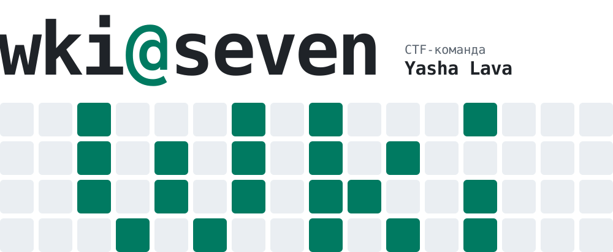
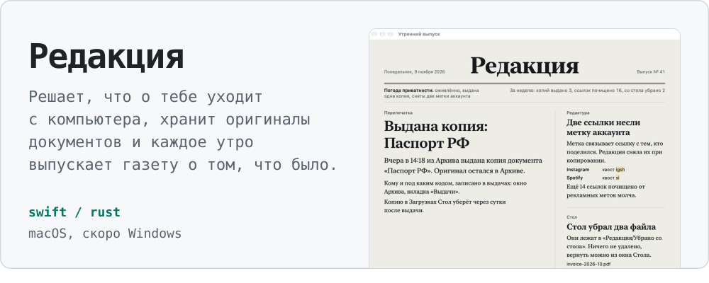
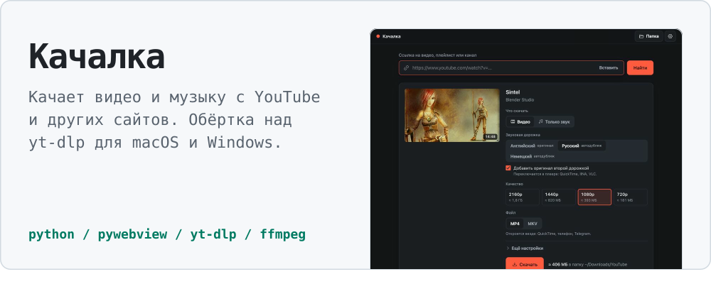
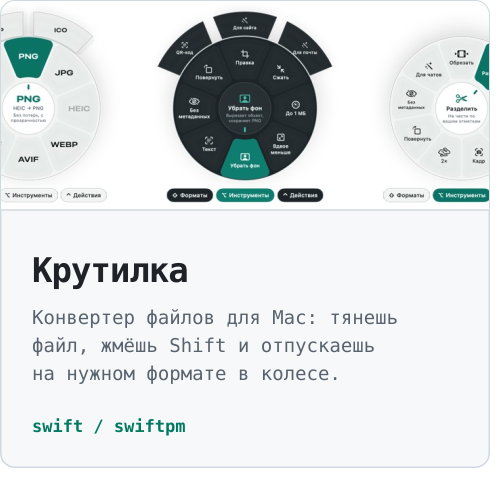
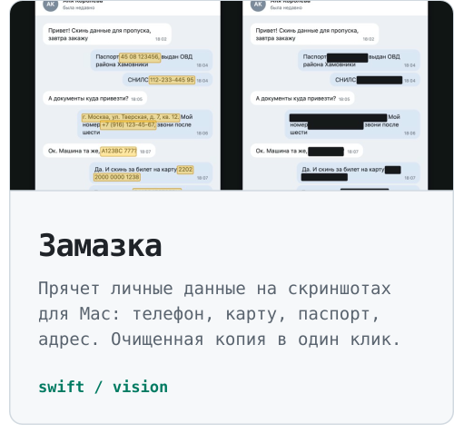
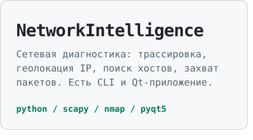
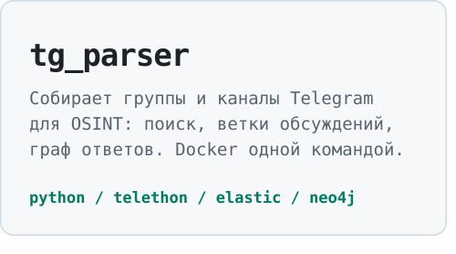
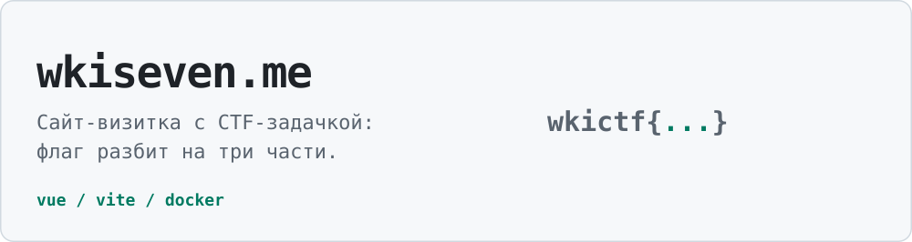

<picture><source media="(prefers-color-scheme: dark)" srcset="https://raw.githubusercontent.com/vldvr/vldvr/main/assets/hero-dark.svg?v=1111"><source media="(prefers-color-scheme: light)" srcset="https://raw.githubusercontent.com/vldvr/vldvr/main/assets/hero-light.svg?v=1111"></picture>

<picture><source media="(prefers-color-scheme: dark)" srcset="https://raw.githubusercontent.com/vldvr/vldvr/main/assets/h-projects-dark.svg?v=1111"><source media="(prefers-color-scheme: light)" srcset="https://raw.githubusercontent.com/vldvr/vldvr/main/assets/h-projects-light.svg?v=1111"></picture>

<a href="https://github.com/vldvr/amendment"><picture><source media="(prefers-color-scheme: dark)" srcset="https://raw.githubusercontent.com/vldvr/vldvr/main/assets/redakciya-dark.svg?v=1111"><source media="(prefers-color-scheme: light)" srcset="https://raw.githubusercontent.com/vldvr/vldvr/main/assets/redakciya-light.svg?v=1111"></picture></a> <a href="https://github.com/vldvr/kachalka"><picture><source media="(prefers-color-scheme: dark)" srcset="https://raw.githubusercontent.com/vldvr/vldvr/main/assets/kachalka-dark.svg?v=1111"><source media="(prefers-color-scheme: light)" srcset="https://raw.githubusercontent.com/vldvr/vldvr/main/assets/kachalka-light.svg?v=1111"></picture></a> <a href="https://github.com/vldvr/krutilka"><picture><source media="(prefers-color-scheme: dark)" srcset="https://raw.githubusercontent.com/vldvr/vldvr/main/assets/krutilka2-dark.svg?v=1111"><source media="(prefers-color-scheme: light)" srcset="https://raw.githubusercontent.com/vldvr/vldvr/main/assets/krutilka2-light.svg?v=1111"></picture></a><a href="https://github.com/vldvr/zamazka"><picture><source media="(prefers-color-scheme: dark)" srcset="https://raw.githubusercontent.com/vldvr/vldvr/main/assets/zamazka-dark.svg?v=1111"><source media="(prefers-color-scheme: light)" srcset="https://raw.githubusercontent.com/vldvr/vldvr/main/assets/zamazka-light.svg?v=1111"></picture></a> <a href="https://github.com/vldvr/Network_Intelligence"><picture><source media="(prefers-color-scheme: dark)" srcset="https://raw.githubusercontent.com/vldvr/vldvr/main/assets/netintel-dark.svg?v=1111"><source media="(prefers-color-scheme: light)" srcset="https://raw.githubusercontent.com/vldvr/vldvr/main/assets/netintel-light.svg?v=1111"></picture></a><a href="https://github.com/vldvr/tg_parser"><picture><source media="(prefers-color-scheme: dark)" srcset="https://raw.githubusercontent.com/vldvr/vldvr/main/assets/tgparser-dark.svg?v=1111"><source media="(prefers-color-scheme: light)" srcset="https://raw.githubusercontent.com/vldvr/vldvr/main/assets/tgparser-light.svg?v=1111"></picture></a> <a href="https://wkiseven.me"><picture><source media="(prefers-color-scheme: dark)" srcset="https://raw.githubusercontent.com/vldvr/vldvr/main/assets/site-dark.svg?v=1111"><source media="(prefers-color-scheme: light)" srcset="https://raw.githubusercontent.com/vldvr/vldvr/main/assets/site-light.svg?v=1111"></picture></a>

<picture><source media="(prefers-color-scheme: dark)" srcset="https://raw.githubusercontent.com/vldvr/vldvr/main/assets/h-ctf-dark.svg?v=1111"><source media="(prefers-color-scheme: light)" srcset="https://raw.githubusercontent.com/vldvr/vldvr/main/assets/h-ctf-light.svg?v=1111"></picture>

В основном беру web, pwn и OSINT. На T-CTF 2025 команда вошла в топ-30.

| Разбор | CTF | Что внутри |
|---|---|---|
| [Капибординг](https://github.com/vldvr/T-CTF_2025_Capibording_writeup) | T-CTF&nbsp;2025 | Stored XSS: бот-лыжник сам донатит сноубордисту 100500 |
| [OnMute](https://github.com/vldvr/HoneyBadger_Writeups/blob/main/OnMute.md) | HoneyBadger&nbsp;2026 | Глобальный RegExp не сбрасывает `lastIndex`, фильтр промахивается |
| [МёдХантер I](https://github.com/vldvr/HoneyBadger_Writeups/blob/main/Medhunter_I.md) | HoneyBadger&nbsp;2026 | SSRF до метаданных Yandex Cloud, оттуда секреты из cloud-init |

<a href="https://t.me/wkiseven"><picture><source media="(prefers-color-scheme: dark)" srcset="https://raw.githubusercontent.com/vldvr/vldvr/main/assets/contact-dark.svg?v=1111"><source media="(prefers-color-scheme: light)" srcset="https://raw.githubusercontent.com/vldvr/vldvr/main/assets/contact-light.svg?v=1111"></picture></a>

Почта [wkiseven@gmail.com](mailto:wkiseven@gmail.com), сайт [wkiseven.me](https://wkiseven.me).
